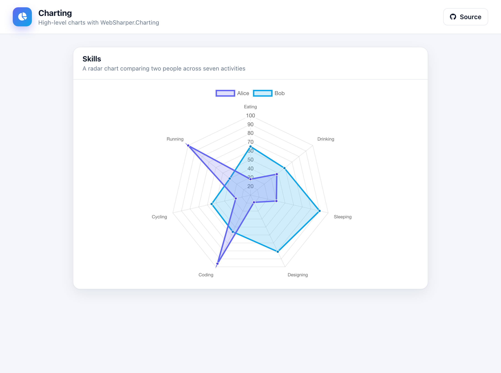

# WebSharper Charting

A radar chart built with the high-level
[WebSharper.Charting](https://github.com/dotnet-websharper/charting) API and
rendered with Chart.js. It compares two people across seven activities.



## How it works

- `src/Client.fs` describes two radar data sets with `Chart.Radar`, combines
  them with `Chart.Combine`, and renders the result with
  `Renderers.ChartJs.Render` into a responsive chart that fills its card.
- `src/wwwroot/index.html` is the whole page — the header and the chart card —
  bound with `.Bind()`.

Chart.js is loaded as a native ES module via an **import map** for the
`chart.js/auto` specifier that the renderer emits.

## Running locally

```
dotnet run --project src
```

Then open <http://localhost:5665>.

## Building

```
dotnet build src/Charting.fsproj -c Release
```

WebSharper compiles the client and [esbuild](https://esbuild.github.io/) bundles
it into `src/wwwroot/Scripts`.

## Deployment

Every push to `master` builds in Release and publishes `src/wwwroot` to the
`gh-pages` branch via `.github/workflows/deploy.yml`.
